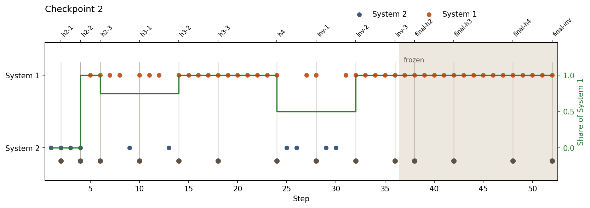

# Checkpoint 2

Checkpoint 2 asks whether a small library of cue–action rules, practiced on a fixed sequence of block towers, can take over from the planner.

The sequence is deliberately narrow. Towers are built from the table, and one pair of blocks is inverted. The result is a preliminary demonstration on that family, not a claim about planning in general.

## What checkpoint 1 established

Checkpoint 1 showed one miniskill. On towers that start with every block on the table, the planner’s `stack` steps repeat a single lifted cue: the hand holds `?x`, `?y` is clear, and `on(?x, ?y)` is in the goal. After two confirmations that cue becomes System 1. A later tower of the same kind uses it. New block names do not matter, because the rule is lifted.

`pickup` did not become System 1. “Clear and on the table” is true of several blocks at once, and two matches are a refusal, not a choice. `putdown` and `unstack` never appeared, because every block started on the table and the plans never took a block off another block.

Three commitments from that checkpoint stay in force.

A rule fires only after the same cue has been followed by the expected effect twice. The step that raises the count from one to two is still the planner. If two rules match, or one rule has two groundings, System 1 proposes nothing. The planner is not removed when a rule exists. It is called at every step the library cannot answer.

The record of a run is the share of steps a practiced rule took, written `s1`, against the steps the planner took, written `s2`. Whether the tower was finished is recorded, and it is not the headline. The planner can finish a tower alone.

The account this follows is recognition, not a second search inside the rule. Simon (1992) treats intuition as recognition. Kahneman and Klein (2009) require a stable environment and practice with a fast, unambiguous check. Kahneman (2011) treats the product of that practice as a miniskill, not as one policy for the whole task. The labels System 1 and System 2 are his, taken from Stanovich and West (2000).

## The checkpoint 2 goal

The next question is transfer along a sequence, not a single operator.

We wanted a series of tasks on which System 1 first has nothing to say, then shares the steps with the planner, and finally answers every step of a new tower on its own. The last block of tasks is frozen: the library may fire, and it may not add or rewrite a rule. If those tasks are entirely System 1, the rules learned earlier are doing the work.

The sequence has to introduce one new cue at a time. A taller tower should reuse the short-tower rules and add the one new pickup. An inverted pair should reuse the tower rules and add unstack and putdown. A later tower with new names should need no new rule.

## The tasks, and what each one is for

The domain is the four blocksworld operators in `cmc/blocksworld.py`: `pickup`, `putdown`, `stack`, and `unstack`. There is no separate PDDL file. A problem is a start state, a goal, and a list of block names. The lesson problems and the frozen problems are `LESSONS` and `FINALS` in `cmc/curriculum.py`. `invert` builds the pair that starts one way and must end the other way.

The hand holds at most one block. A goal is a set of `on` atoms. The predicate `base(?y)` is read off that set: `?y` is the support of some block and is never itself the top of an `on` atom. It is not computed by search.

Five rules are the whole library. Each one is a lifted cue, one action, and a confirmation count. The count starts at zero. Only a planner step may create a count or raise it through the threshold. A System 1 success raises the count of a rule that has already passed the threshold. It does not write a new rule.

| Order | Task | What the scene adds | Rule the planner can confirm |
| --- | --- | --- | --- |
| 1–3 | Height 2, three towers | `on(?x, ?y)`, and `?y` is a base | `pickup-base`, then `stack` |
| 4–6 | Height 3, three towers | The top block’s support is already a finished goal atom | `pickup-next` |
| 7 | Height 4, new names | No new cue | None. The three rules above already cover it |
| 8–10 | Invert a pair, three times | The start has a block on the wrong block | `unstack`, then `putdown` |
| 11–14 | Frozen copies, new names | Same four kinds of scene, learning off | None |

The expected course of learning follows from the threshold of two.

On the first height-2 tower both cues are new, so both steps are the planner. Each rule ends at count 1. On the second tower the same cues appear again. Those steps raise the counts from 1 to 2, so they are still the planner. On the third tower both rules are practiced, and both steps are System 1.

On the first height-3 tower the base block is picked up and stacked by the practiced rules. The next block is a new cue, `pickup-next`, so that one step is the planner and the count ends at 1. The second height-3 tower raises it to 2, still with the planner. The third is four System 1 steps.

The height-4 tower uses `pickup-base` for the base, `pickup-next` twice for the blocks above it, and `stack` three times. No cue is new.

On the first inversion the top block is on the wrong support, and the goal does not ask for that `on` atom. That is `unstack`. The block also has nowhere it belongs, which is `putdown`. Both are new, so those two steps are the planner. The pair is then built with the height-2 rules. The second inversion raises `unstack` and `putdown` to 2. The third is four System 1 steps.

The frozen block repeats one tower of each height and one inversion, with names that did not appear in the lessons, and with learning switched off. Every step should be System 1. The counts should not move.

The cues are the following. A rule is eligible only when its count is at least 2. If several groundings are eligible, the step is refused and the planner is called.

**pickup-base.** The hand is empty. `?x` and `?y` are distinct, clear, and on the table. The goal contains `on(?x, ?y)`, and `?y` is a base. Action: `pickup(?x)`.

**pickup-next.** The hand is empty. `?x` is clear and on the table. `?y` is clear. `on(?y, ?z)` is already true and is in the goal, and the goal also contains `on(?x, ?y)`. Action: `pickup(?x)`.

**stack.** The hand holds `?x`, `?y` is clear, and the goal contains `on(?x, ?y)`. Action: `stack(?x, ?y)`.

**unstack.** The hand is empty, `?x` is clear, `on(?x, ?y)` is true, and that atom is not in the goal. Action: `unstack(?x, ?y)`.

**putdown.** The hand holds `?x`, and the goal has no `on(?x, _)`. Action: `putdown(?x)`.

`pickup-base` carries the base literal so that a height-2 cue and a later “pickup the next block” cue are not the same pattern. Without it, one coarse pickup would match two blocks and would have to refuse. Two blocks that are both on the wrong support still match `unstack` twice, and that step stays with the planner. A block that is already on its goal support, while that support itself must move, is also outside this family.

## System 2

Checkpoint 1 searched breadth-first and returned a shortest plan. For actions of equal cost, that is a comparison: every cheaper plan has been ruled out before the search stops. That is not the stop rule in the work this checkpoint follows.

Simon (1955) defines satisficing as search that stops at the first option good enough for the aspiration, rather than at a proven best. Klein’s recognition-primed decision (Klein, Calderwood, and Clinton-Cirocco, 1986; Klein, 1989) is the same stop in a stronger form. The decision maker generates one option by recognition and runs a mental simulation of that option. If the story holds, the option is taken. Other options are not generated for comparison. Kahneman and Klein (2009) adopt that account for skilled intuition in a high-validity setting. Kahneman (2011) repeats it: the check is serial and effortful, and it is a check of a candidate, not an optimization.

None of those sources describe a PDDL tree. The adaptation is the stop, not the generator. System 2 here is still a planner, because it must not be handed the structure of a tower in advance. What it returns is the first plan that reaches the goal. It does not look for a shorter one.

The procedure is enforced hill-climbing, from Hoffmann and Nebel (2001). From the current state, breadth-first search runs only until some state has a strictly better score. That path is kept, and the climb repeats from the new state until the goal or a depth bound. The bound is eight times the number of blocks. The search is in `cmc/planner.py`.

The score is the number of goal atoms that are false in the state. It does not mention towers, bases, or operator order. An earlier score that counted an `on` atom only when the tower under it was already in place was rejected: that score already knew how a tower is built, which is what the traces are supposed to teach.

A goal-count climb can still write a detour. On three blocks that must end as `a` on `b` on `c`, the raw climb picks up `a`, stacks it, takes it off, puts it down, and only then builds from `b`. Two states in that story are visited twice. Before anything is executed, those cycles are deleted. What remains begins with `pickup(b)`. A detour that never repeats a state is not deleted. A library that has learned only `stack`, and is then given four blocks, still stacks the top block before the base, takes it off, and continues. That episode is longer than the shortest plan from checkpoint 1. It does reach the goal, and it does not repeat a state. The lesson sequence does not meet this case: by the height-4 tower, `pickup-base` is already practiced, so the planner is not asked to order the tower.

The episode does not execute the remaining plan. It executes the first action of what survived the cut, then the loop starts again and System 1 is offered the real next state.

That commitment is Klein’s, with a limit we should state. In the recognition-primed account the simulation looks ahead, and the action that is carried out is the one action the story accepted (Klein, 1989; Kahneman and Klein, 2009). Later actions in the story are the check, not a schedule. Once the action has been taken, the next real state is a new occasion for recognition, which is how a practiced miniskill can take the step the planner had written down but not executed (Kahneman, 2011). Mapping that onto “keep `plan[0]` and discard the rest” is our reading. It is what lets System 1 return on the very next step. It is not a sentence in Kahneman that says a computed plan should be thrown away. The place where this reading parts from his lazy System 2 is in the section on what is still not aligned.

## Memory across a step

Klein’s simulation does not end when the action is rejected. The rejected action and the expectation that remains stay in mind, and the next moment is not treated as a fresh problem (Klein, 1989). Kahneman’s System 2 is the system that can hold such a series (Kahneman, 2011).

This checkpoint does not do that. Every step sees the current state, the goal, and the library. It does not remember which continuation was cut, or which action was tried and undone. The within-plan cut is only a filter on the story just written. After the one action is executed, the next call is myopic.

Keeping the rejected action across the real next state is left for later. It is not part of the checkpoint 2 result.

## Results

The lesson order in `cmc/curriculum.py` was run with learning on, and the four frozen problems with learning off. All 14 tasks reach the goal. The run is 52 steps. No practiced rule fires with a failed effect (`s1_bad` stays 0). The figure is `results/ckpt2.png`.



The horizontal axis is the step, not the task. A gray vertical line marks the step on which a task ends, and the name of the task is written above that step. The dot under the line is filled when the goal was reached. An unfinished task would end on an open dot. This run has none. A task that wandered would be a long run of dots before its mark. The longest task here is the height-4 tower, six steps.

The green line is the share of System 1 inside the task that is underway. It is flat across that task’s steps and jumps vertically when the next task starts. It is not the cumulative share from the first step of the whole run. Early planner steps would keep a cumulative share below 1 even after the library had taken over.

The shape is two rises, a dip, and a flat tail.

The first two height-2 towers are entirely System 2. The third is entirely System 1. The first two height-3 towers are three System 1 steps and one planner step, the new `pickup-next`. The third height-3 tower and the height-4 tower are entirely System 1. The first two inversions drop back to half, because `unstack` and `putdown` are new. The third inversion returns to System 1. The shaded frozen block stays there, on new names, with learning off.

The sources, in order, are:

| Task | Who acts |
| --- | --- |
| h2-1, h2-2 | `s2 s2` |
| h2-3 | `s1 s1` |
| h3-1, h3-2 | `s1 s1 s2 s1` |
| h3-3 | `s1 s1 s1 s1` |
| h4 | `s1` six times |
| inv-1, inv-2 | `s2 s2 s1 s1` |
| inv-3 | `s1 s1 s1 s1` |
| final-h2 | `s1 s1` |
| final-h3 | `s1 s1 s1 s1` |
| final-h4 | `s1` six times |
| final-inv | `s1 s1 s1 s1` |

Counts after each lesson, in the order `pickup-base`, `pickup-next`, `stack`, `unstack`, `putdown`:

| After | Counts |
| --- | --- |
| h2-1 | 1, 0, 1, 0, 0 |
| h2-2 | 2, 0, 2, 0, 0 |
| h2-3 | 3, 0, 3, 0, 0 |
| h3-1 | 4, 1, 5, 0, 0 |
| h3-2 | 5, 2, 7, 0, 0 |
| h3-3 | 6, 3, 9, 0, 0 |
| h4 | 7, 5, 12, 0, 0 |
| inv-1 | 8, 5, 13, 1, 1 |
| inv-2 | 9, 5, 14, 2, 2 |
| inv-3 | 10, 5, 15, 3, 3 |

The frozen block does not change these counts.

The ruleset at the end of the lessons is the five cues above, with those final counts.

**pickup-base.** Count 10. Empty hand; `?x` and `?y` clear and on the table; goal `on(?x, ?y)`; `?y` a base. Action `pickup(?x)`.

**pickup-next.** Count 5. Empty hand; `?x` clear and on the table; `?y` clear; `on(?y, ?z)` true and in the goal; goal `on(?x, ?y)`. Action `pickup(?x)`.

**stack.** Count 15. Holding `?x`; `?y` clear; goal `on(?x, ?y)`. Action `stack(?x, ?y)`.

**unstack.** Count 3. Empty hand; `?x` clear; `on(?x, ?y)` true and absent from the goal. Action `unstack(?x, ?y)`.

**putdown.** Count 3. Holding `?x`; no `on(?x, _)` in the goal. Action `putdown(?x)`.

## Where this follows the cited work, and where it does not

**Recognition, and a miniskill rather than a policy.** System 1 proposes by matching one cue to one action. That is Simon’s (1992) account of intuition, and it is the recognition step in Klein (1989). The library is five separate cues. A height-4 tower reuses the height-2 and height-3 cues instead of requiring a new rule for “build a tower of four.” That split follows Kahneman’s (2011) description of expertise as a collection of miniskills, and the fractionation in Kahneman and Klein (2009): a change of scene that changes the cue is a different skill.

**Practice, and a check that can say no.** A rule is silent until the same cue has been followed by the expected effect twice. Kahneman and Klein (2009) require prolonged practice and rapid, unequivocal feedback before an intuition is skilled. They do not give the number two. The number is ours. While the count is below two, the planner’s step is the practice. Confidence is not treated as a substitute for that count.

**One match, or no action.** If two groundings fit, System 1 refuses. Comparison and the last word belong to System 2 (Kahneman, 2011). There is no tie-break by block name.

**The planner stays.** System 2 is called whenever recognition fails. It is not a teacher that is switched off after the lessons. On the frozen tasks it happens to be idle because every cue matches once.

**Satisficing, adapted to a planner.** The stop is the first plan that reaches the goal (Simon, 1955; Klein, 1989; Kahneman and Klein, 2009). Enforced hill-climbing is the planning procedure that already stops this way (Hoffmann and Nebel, 2001). We changed the score to a count of missing goal atoms so the procedure would not contain a theory of towers. We added a cut when the story visits a state twice, as a stand-in for Klein’s (1989) check that an action must not be one the story itself undoes.

**One action is executed.** The rest of the plan was the look-ahead. The next real state is offered to recognition again (Klein, 1989; Kahneman, 2011). That is why a planner pickup can be followed, on the next step, by a practiced `stack`.

Several differences remain, and they are real limits of this checkpoint.

The search is myopic across steps. Klein’s (1989) rejected action and remaining expectation are not stored, and Kahneman’s (2011) System 2 is not holding a series from one step to the next. Section “Memory across a step” is the explicit deferral.

A lazy System 2 that had already built a series would not recompute it after every successful step (Kahneman, 2011). We recompute because we kept only one action. That is a choice about where System 1 is allowed to re-enter, not a claim that he prescribed it.

The generator is not recognition of a single option. Each hill-climbing probe is still a breadth-first search over many applicable actions. Klein (1989) generates one option and simulates that one. Simon’s satisficing and an IPC satisficing planner share the stop. They do not share the source of the first candidate.

The missing-atom score can treat a true goal atom as progress even when a later step must undo it. The cut removes only the case that repeats a state. The four-block episode with a stack-only library is the example: the detour does not repeat a state, so it remains.

The cue literals are written in the program. Experience decides when a cue becomes System 1. It does not decide which literal the cue contains. An open induction over candidate literals is not part of this checkpoint.

“Entirely System 1” means this family: towers built from the table, and one clear block on the wrong block. Two misplaced blocks at once, or a block sitting on a support that itself must move, stay with the planner. The threshold of two is a parameter.

## Conclusion

On a sequence chosen so that each new scene adds one cue, the library moves from planner steps, through shared steps, to tasks that System 1 finishes alone. A frozen repeat with new names stays on System 1. The planner that supplies the practice returns the first plan that reaches the goal, drops a cycle inside that plan, and yields the first remaining action.

This is a preliminary demonstration on that carefully limited family. Checkpoint 3 is to take the same division of labor outside it.

## How to reproduce

From `cmc_project`:

```bash
python -m unittest tests.test_ckpt2 tests.test_ckpt1
python scripts/run_ckpt2.py
python scripts/plot_ckpt2.py
```

The second command writes `results/ckpt2.txt`. The third writes `results/ckpt2.png`.

## References

Hoffmann, J., & Nebel, B. (2001). The FF planning system: Fast plan generation through heuristic search. *Journal of Artificial Intelligence Research, 14*, 253–302.

Kahneman, D. (2011). *Thinking, fast and slow*. Farrar, Straus and Giroux.

Kahneman, D., & Klein, G. (2009). Conditions for intuitive expertise: A failure to disagree. *American Psychologist, 64*(6), 515–526.

Klein, G. A. (1989). Recognition-primed decisions. In W. B. Rouse (Ed.), *Advances in man-machine systems research* (Vol. 5, pp. 47–92). JAI Press.

Klein, G. A., Calderwood, R., & Clinton-Cirocco, A. (1986). Rapid decision making on the fire ground. *Proceedings of the Human Factors Society Annual Meeting, 30*(6), 576–580.

Simon, H. A. (1955). A behavioral model of rational choice. *The Quarterly Journal of Economics, 69*(1), 99–118.

Simon, H. A. (1992). What is an “explanation” of behavior? *Psychological Science, 3*(3), 150–161.

Stanovich, K. E., & West, R. F. (2000). Individual differences in reasoning: Implications for the rationality debate? *Behavioral and Brain Sciences, 23*(5), 645–665.
