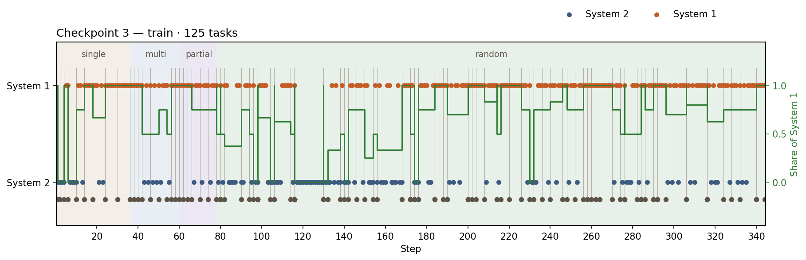
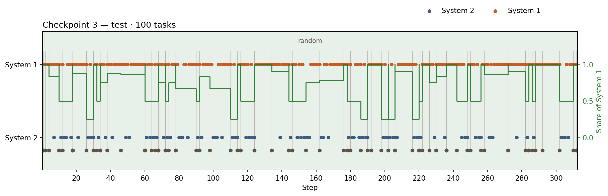

# Checkpoint 3

Checkpoint 3 asks whether the System 1 / System 2 split still works when rules are **induced** from experience, on a **generator** of multi-tower problems, rather than on hand-written cues and a fixed lesson list.

## What checkpoint 2 showed, and what changed

Checkpoint 2 kept Kahneman’s division of labor on a carefully chosen blocksworld sequence (Kahneman, 2011; Kahneman and Klein, 2009; Stanovich and West, 2000). System 2 was a satisficing planner (enforced hill-climbing; Hoffmann and Nebel, 2001). System 1 was a library of lifted cue–action rules. A rule fired only after the same cue had been followed by the expected effect twice, and only when exactly one grounding matched. Several matches meant refusal, not a lexicographic pick. The planner stayed in the loop. The headline metric was the share of steps System 1 took, not whether the tower was finished.

The important limit of that checkpoint was this: the five cues (`pickup-base`, `pickup-next`, `stack`, `unstack`, `putdown`) were **hand-specified**. Experience only raised confirmation counts. Checkpoint 2 therefore answered a narrower question: *given* a set of rules I wrote, does practice plus unique recognition transfer control to System 1 in a way that respects Kahneman’s conditions?

It did, on that narrow family. After the scheduled lessons, a frozen block with new names was entirely System 1. That is the baseline this note extends.

Checkpoint 3 changes two things.

1. **Rule discovery.** Default learning starts from an empty library. Rules are induced from executed System 2 plan traces, using only the domain operator model and those traces. The hand schemas remain available behind `--known_rules` for comparison; they are not the claim of this checkpoint.
2. **Problem family.** Tasks are no longer a fixed list of named towers. A generator samples complete multi-tower goals (with `on`, `ontable`, `clear`, `handempty`) over at most `n` blocks. Training still uses an ordered curriculum, but the instances inside each phase are generated, and the final phase is a long random tail.

## Checkpoint 3 goal

The next step is continual learning of recognition cues from planner experience, on a broader family of stacking problems.

The generator can emit any complete multi-tower problem in that bound. Learning is run under a progressive schedule: all blocks on the table and a single tower, then multi-tower goals from the table, then partial towers toward a complete goal, then random initial states with complete goals. That order is oracle knowledge about a useful curriculum for this domain. For checkpoint 3 that is allowed. The claim is not that the curriculum was discovered; the claim is that, under that curriculum, induced rules take an increasing share of the steps on generated problems, including a long random phase.

## How induction works (and how it differs from PG3)

PG3 learns lifted decision-list policies for PDDL domains (Yang et al., 2022). The hypothesis class is close to ours: parameters, state conditions, goal conditions, one action. We keep that form.

We do not keep PG3’s training recipe. PG3 searches over candidate lists with an outer greedy best-first search. It scores a list by running policy-guided planning: an inner A* that can roll the candidate for many free steps. That uses the planner as an evaluator of hypothetical policies on problems that need not have been experienced as a stream of executed decisions. The end condition is a list that can replace the planner on held-out instances.

In Kahneman’s framing, skilled intuition comes from prolonged practice with feedback in a high-validity environment (Kahneman and Klein, 2009). System 1 proposes by recognition; System 2 has the last word when recognition fails (Kahneman, 2011). Continual learning from **executed** experience fits that better than an offline search over policies that rolls candidates through states the agent never visited.

So induction here is experience-driven:

- When System 1 cannot uniquely propose, System 2 returns a satisficing plan. The episode executes the first action (after loop cutting). That `(state, goal, action, plan)` is the lesson.
- A new rule’s action is that missed action. Its state seed is the operator preconditions from the domain model (`cmc/domain.py`). Its goal conditions may include the complete goal literals of that problem (and the permanent goal atom achieved along the plan fragment). Further state or negative-goal literals are added only when needed so the rule uniquely recovers the recorded action on known traces.
- A rule does not fire as System 1 until the practice threshold (still 2). The step that crosses the threshold is still System 2.
- Later traces can **repair** an over-specific goal cue by dropping goal literals that cannot hold on the new problem, while staying consistent with past traces. That replaces predicate blacklists and hand-written “base” tests.
- Unique grounding remains mandatory. Two matches refuse. The planner stays.

PG3 and this system share a rule shape and the idea of inducing from planning experience. They diverge on search over policies, zero-cost rollouts, and deleting the planner at test time. Checkpoint 3 keeps the planner and learns online from the stream.

## Setup

- Domain and complete goals: `cmc/blocksworld.py`, operators in `cmc/domain.py`.
- Generator and curriculum: `cmc/generate.py` (`PHASES = single → multi → partial → random`).
- Induce library: `cmc/induce.py` (default). Hand schemas: `SkillLibrary(known_rules=True)`.
- Run train: `python scripts/run_generate.py --train --n 4 --practice 2 --random-count 100` (writes the log and `results/ckpt3_rules.json`).
- Run test: `python scripts/run_generate.py --test --n 4 --test-count 100` (loads saved rules; no warmup; 100 frozen random tasks).

Reported train: `n=4`, `practice=2`, `seed=0`, `random_count=100`. Reported test: same `n`/`seed`, `test_count=100`, rules from that train.

## Results

Figures are drawn from the mode logs without re-running (`python scripts/plot_ckpt3.py --log results/ckpt3_train.txt` or `--log results/ckpt3_test.txt`). Titles name the mode and task count.





All 125 tasks reached the goal (10 + 9 + 6 + 100). System 1 share is the fraction of steps with source `s1`.

| Phase | Tasks | Reached | Steps | System 1 steps | System 2 steps | System 1 share |
| --- | ---: | ---: | ---: | ---: | ---: | ---: |
| single | 10 | 10/10 | 36 | 25 | 11 | 0.694 |
| multi | 9 | 9/9 | 24 | 21 | 3 | 0.875 |
| partial | 6 | 6/6 | 18 | 15 | 3 | 0.833 |
| random | 100 | 100/100 | 266 | 207 | 59 | 0.778 |
| **overall** | **125** | **125/125** | **344** | **268** | **76** | **0.779** |

On the random tail, within-task System 1 share stays high through the phase (about 0.84 on the first ten tasks, about 0.94 in the middle, about 0.88 on the last ten). It is not a flat 1.0: new random scenes still force refusals and planner steps. That is expected once several towers and partial stacks make unique recognition fail.

The library ended with 16 induced rules. The heavily practiced ones (confirmation count in parentheses) were two `pickup` cues (66, 34), one `stack` (112), one `unstack` (39), and one `putdown` (43), plus several lower-count unstack/putdown specializations from the random phase. Counts below the threshold never fire.

## What this does and does not claim

It shows that, under a progressive generated curriculum with a long random tail, rules induced only from the domain model and System 2 traces can carry most steps while the planner remains for gaps and for practice.

It does not show that the curriculum order was learned. It does not show a single compact decision list that replaces the planner. It does not claim alignment with every detail of Klein’s recognition-primed decision account (cross-step memory of a rejected action is still absent). Completeness of goals (`ontable`, `clear`, `handempty`) is part of the problem language; induction may store those literals from a trace and repair them later.

## Conclusion

Checkpoint 2 showed the Kahneman-style loop with hand-crafted rules on a fixed schedule. Checkpoint 3 removes the hand-crafted rule set and the fixed instance list. Rules are induced online from planner traces and the operator model. Problems come from a multi-tower generator, trained in a progressive order that ends with 100 random tasks. In the reported run, every task succeeded and System 1 took about 78% of all steps, including about 78% of the random-tail steps, with the planner still answering when recognition was absent or ambiguous.

## How to reproduce

From `cmc_project`:

```bash
python -m unittest tests.test_generate tests.test_induce_repair tests.test_ckpt2
python scripts/run_generate.py --train --n 4 --practice 2 --seed 0 --random-count 100
python scripts/run_generate.py --test --n 4 --seed 0 --test-count 100
python scripts/plot_ckpt3.py --log results/ckpt3_train.txt --out results/ckpt3_train.png
python scripts/plot_ckpt3.py --log results/ckpt3_test.txt --out results/ckpt3_test.png
```

Train writes `results/ckpt3_train.txt` and `results/ckpt3_rules.json`. Test loads those rules and writes `results/ckpt3_test.txt`.

## References

Hoffmann, J., & Nebel, B. (2001). The FF planning system: Fast plan generation through heuristic search. *Journal of Artificial Intelligence Research, 14*, 253–302.

Kahneman, D. (2011). *Thinking, fast and slow*. Farrar, Straus and Giroux.

Kahneman, D., & Klein, G. (2009). Conditions for intuitive expertise: A failure to disagree. *American Psychologist, 64*(6), 515–526.

Simon, H. A. (1992). What is an “explanation” of behavior? *Psychological Science, 3*(3), 150–161.

Stanovich, K. E., & West, R. F. (2000). Individual differences in reasoning: Implications for the rationality debate? *Behavioral and Brain Sciences, 23*(5), 645–665.

Yang, R., Silver, T., Curtis, A., Lozano-Pérez, T., & Kaelbling, L. P. (2022). PG3: Policy-guided planning for generalized policy generation. *Proceedings of the Thirty-First International Joint Conference on Artificial Intelligence*, 4684–4690. arXiv:2204.10420.
